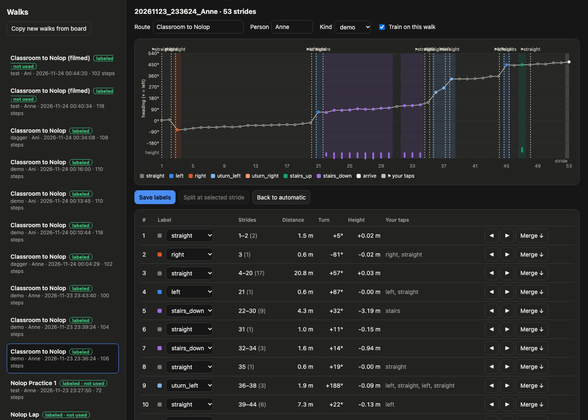

# BehaviorCloningNavigation

A campus navigator that needs **no GPS, Wi-Fi positioning or camera**. You wear the [StepCounter](../StepCounter/) ankle sensor (Arduino UNO Q + MPU-6050), start at the classroom, and a phone tells you what to do next — *"Go straight"*, *"Turn left"*, *"Stairs down"*, *"Turn around to the left"*, *"You've arrived"* — all the way to Nolop. Where you are on the route comes only from your own steps: how far you've walked, which way you've turned, and when you went up or down stairs.

The navigator is **behavior-cloned**: it learned the route from 6 demonstration walks (3 each by Anne and Ani) plus 2 **DAgger** walks in which it guided us and we corrected its mistakes. That's 8 of the allowed 10 walks.

- **Video:** _TODO: link_
- **Notion page:** _TODO: link_
- **Phone page:** http://172.20.10.14:7000 (board and phone on the iPhone hotspot)

## Results

In the two filmed runs, each guided to Nolop by the final 8-walk navigator, **every instruction came on time** (none late or missed):

| Filmed run (test walk, not trained on) | Instructions on time | Stride accuracy | Brief false alarms |
|---|---|---|---|
| Anne | **8 / 8** | 83% | 4 |
| Ani | **7 / 7** | 87% | 4 |

*On time* = said on or before the stride where it happens. *Stride accuracy* = how often, after a stride, it said exactly what the walker did next. A *false alarm* is a moment where it said a turn or stairs and you went straight (e.g. a turn one stride early). Ani's walk has 7 events, not 8: the step up near Nolop measured under the stairs threshold on that walk, though the navigator still said "Stairs up" there. In both runs we moved around for the camera after "You've arrived"; those strides are counted as arrival.

**How it improved with data** — each walk is guided by a model trained *without* it (leave-one-walk-out):

| Training walks | Instructions on time | Late | Stride accuracy | False alarms |
|---|---|---|---|---|
| 3 demos (Anne) | 22 / 24 | 0 | 90% | 6 |
| 6 demos (Anne + Ani) | 41 / 47 (87%) | 0 | 86% | 20 |
| + Anne's DAgger walk | 51 / 56 (91%) | 0 | 88% | 21 |
| **+ Ani's DAgger walk (final)** | **60 / 64 (94%)** | **0** | **88%** | 25 |

The rows aren't over the same walks: each row tests every walk it trains on, so later rows include harder walks (Ani's; see below). Full output: [report.txt](training/results/policy/report.txt).

**Someone the navigator has never seen.** We had no newcomer to film, so the closest measurement is a **leave-one-person-out** test: train on one of us, guide the other.

| Trained on | Guiding | Demos only | Demos + DAgger |
|---|---|---|---|
| Ani only | Anne (4 walks) | 22 / 33 (67%) | **26 / 33 (79%)** |
| Anne only | Ani (4 walks) | 24 / 31 (77%) | **26 / 31 (84%)** |
| both of us (other walks) | either | — | **60 / 64 (94%)** |

A model trained on one person gets about 80% of instructions on time for someone new; training on two walkers raises it to 94%. A true newcomer would likely fall in between. DAgger helped in both directions.

## Hardware

The StepCounter wearable, unchanged: everything is worn at the ankle in one 3D-printed housing (UNO Q, battery, GY-521 / MPU-6050).

| GY-521 | UNO Q |
|---|---|
| VCC | 5V |
| GND | GND |
| SDA | SDA / D20 |
| SCL | SCL / D21 |

Axes as mounted: **X up the leg, Y forward, Z to the left**. 100 Hz, ±16 g, ±2000 °/s. The phone is only a screen and speaker: it shows the board's web page and reads the instructions aloud. No phone sensors are used.

## How it works

```
 ankle, every sample (100 Hz)            every stride of the sensor foot              navigator
 ────────────────────────────            ───────────────────────────────              ─────────
 MPU-6050 ─► sketch.ino ─► Bridge ─► main.py
                                      ├─ step net (StepCounter) ──► heel strikes ─┐
                                      ├─ heading.py (gyro) ───────► heading ──────┼─► stride: distance (ZUPT),
                                      └─ ZUPT (stepnet.py) ───────► height ───────┘   height change, turn
                                                                                          │
                                                       policy.py: state after this stride ┘
                                                       (distance, turns & flights so far, …)
                                                                     │  k-nearest neighbours
                                                                     ▼  over the 8 training walks
                                                   "Turn left"  ─► phone (big arrow + speech) and LED matrix
```

As the assignment suggests, it's built on the step counter rather than raw IMU data: the navigator never sees a raw sample. Its unit is the **stride** (heel strike to heel strike of the sensor foot = two steps, about 1.3 m).

### From steps to strides

- **Steps:** the StepCounter's neural net ([stepnet.py](campus-nav/python/stepnet.py), weights in [stepnet.json](campus-nav/python/stepnet.json)) finds each heel strike of the sensor foot.
- **Distance and height** per stride come from **ZUPT**: the foot is still while it's planted, so the acceleration between two plants can be integrated twice, with any leftover velocity removed as drift. The horizontal part is the stride length; the vertical part shows stairs. On the StepCounter's stair trials, stair strides came out at about **±0.4 m** and level ones at about **0 m**, so a stride rising or dropping **0.2 m** or more counts as stairs. The first stride after standing is measured from the moment the foot was last still, so the first stair of a flight isn't missed.
- **Heading** ([heading.py](campus-nav/python/heading.py)) integrates the gyro's rotation about "up". "Up" changes as the shank swings, so it's tracked with the gyro and nudged toward gravity whenever the accelerometer reads about 1 g. The gyro's bias is measured whenever you stand still for half a second. An earlier version averaged the accelerometer to find "up"; on the first practice walk it drifted **−12.6° per straight stride**, and tracking "up" brought that to about **0°**. On the real route's ~19 m hallway it still drifts **1–5° per stride** (15–90° over the hallway, more on Ani's walks), but corners stand out clearly at 60–100° within a stride or two.

### The navigator ([policy.py](campus-nav/python/policy.py))

**State** after each stride, all from the strides so far:

| Feature | Why |
|---|---|
| metres walked since Start | rough position along the route |
| left turns, right turns, flights of stairs so far | which leg of the route you're on |
| metres since the last turn or flight | position within that leg |
| total heading change since Start | which way you're facing |
| turn on the last stride and last two strides, height change on the last stride | what you're doing right now |

A turn is a run of strides that each turn at least 20° the same way and together turn at least 45° (135° or more is a U-turn). Turns are counted from the heading, so a turn you make counts whether or not the navigator told you to.

**Action:** what to say next: `straight`, `left`, `right`, `uturn_left`, `uturn_right`, `stairs_up`, `stairs_down` or `arrive`. Training target: what the demonstrator did on the next stride, or the next turn, stairs or arrival if it comes within **2 strides**. The board only knows about a stride about a second after it ends, so looking 2 strides ahead makes "Turn left" arrive at about the corner instead of after it.

**Model: k-nearest neighbours** (k = 5, distance-weighted). Every stride of every training walk is a stored example (state → what was done next). To decide, the board finds the 5 most similar stored states and takes a weighted vote. With fewer than 10 walks (436 examples), that's about as much model as the data can support. It needs no training run, runs in numpy on the board, and each decision can be explained by pointing at the walks it came from. Features are scaled by hand so that one extra turn counts as much as 4 m walked or a 90° heading difference.

### Labeling ([label_walks.py](training/label_walks.py))

Labeling during a demonstration is hard, so **nothing has to be labeled while walking**. Turns and stairs are found afterwards from the heading and height (optional taps on the phone are shown for reference). A local web page shows each walk as a heading chart and a table of segments to correct before training:



Corrections we made, and the rule changes that came out of them:
- **Landings misread as `stairs_up`** in the middle of a flight going down (the foot's motion changes on the landing): relabeled `stairs_down` or `straight`.
- **The U-turn after the stairs.** Anne walked it as one smooth ~180° turn; Ani sometimes as left, one straight stride, left. All were labeled `uturn_left`, so the navigator says "Turn around to the left" once instead of two lefts a second apart. The U-turn label was added for this.
- **A turn split over two strides** was labeled on both. That taught the first navigator to keep saying "right" just after you'd turned right. Now only the stride where a turn *starts* teaches "turn"; stairs stay "stairs" for the whole flight.

### DAgger

In the phone's **Navigate** tab the navigator guides you. When it's wrong, you tap what it *should* say and keep walking the right way. Each stride is saved with what the navigator said, and the walk is labeled from what you actually did, the same way as a demonstration. Retraining with these walks adds examples from exactly the situations where the navigator went wrong. Anne's DAgger walk (9 corrections, guided by the 3-walk model) and Ani's (5 corrections, 7-walk model) raised on-time instructions from 87% to 94%. Ani's DAgger walk was itself guided with **8 / 8** instructions on time.

## Using it

**Board:** deploy [campus-nav/](campus-nav/) as an App Lab app (`python3 deploy.py <path>/campus-nav/app.yaml`). It's the board's default app, so it starts on battery power. The board joins the iPhone hotspot ("Maximize Compatibility" on, so it's on 2.4 GHz). Open the phone page on any device on the hotspot.

1. **Record** tab, for a demonstration: pick who's wearing it, type the route, stand still 2 s at the start (facing the same way every time), press **Start**, walk, press **Stop & save**. Wait for **"Walk saved. Safe to unplug."** before unplugging. Files are forced onto the storage card every second, and a walk cut off by a power loss gets its summary rebuilt at the next start.
2. **Label** on the laptop, board on USB: `python3 training/label_walks.py` copies new walks off the board and opens the labeling page. Fix anything wrong, tick **Train on this walk**, **Save**.
3. **Train and deploy:** `python3 training/train_policy.py --deploy`. It prints the leave-one-walk-out test ([report.txt](training/results/policy/report.txt)), writes [policy.json](campus-nav/python/policy.json) and pushes it to the board. It's picked up at the next walk, with no restart.
4. **Navigate** tab: **With corrections (DAgger)** to collect corrections, **Test** to just be guided (test walks are never trained on). Instructions are spoken and shown as a big arrow; the LED matrix shows the arrow too.

The laptop side needs only Python 3 and numpy.

## Data

| | Walks | Who | Strides |
|---|---|---|---|
| Demonstrations | 6 | Anne ×3, Ani ×3 | 50–58 each |
| DAgger | 2 | Anne, Ani | 51, 54 |
| **Trained on** | **8 of 10 allowed** | | 436 examples |
| Filmed test runs (not trained on) | 2 | Anne, Ani | 59, 51 |
| Practice loop and early tests (not trained on) | 2 | Anne | 36 each |

Route: classroom → right → ~20 m hallway → left → stairs down (one landing) → U-turn left → ~7 m → left → short step up → ~5 m → Nolop. About 44–53 m by ZUPT, 50–59 strides, 65–100 s.

Every walk is in [walks/](walks/): raw IMU (`imu.csv`), the board's live stride log including what the navigator said (`strides.csv`), phone taps and corrections (`marks.csv`), and the reviewed labels (`labels.json`, `labels.csv`). Strides are always recomputed from the raw IMU with the current code, so improvements apply to old walks too.

## Limitations

- **Position comes partly from distance**, and distance differs between people. The board measured Ani's walks of the same route at 44–53 m, against Anne's 46–48 m, and most of the misses are on Ani's walks. Training on both of us and DAgger fixed most of this; features that adjust for each walker's stride would help a new person.
- **Fixed start.** Heading is relative to where you faced at Start, and the route is learned, not mapped, so you must start at the classroom spot facing the usual way. The navigator knows only this route.
- **Wrong turns aren't recovered.** If you walk off the route, the state no longer matches anything in training, and the navigator has no notion of "go back".
- **Short events are hardest.** The one-stride step up right after the last left was the most-missed instruction until DAgger.
- **Latency.** A stride is known about 1 s after its heel strike, which is why instructions are aimed 2 strides ahead. That also causes a few one-stride-early instructions (most of the false alarms).
- **Heading drift** of 1–5° per stride on long straight stretches (see above). The navigator mostly relies on turn counts and per-stride turns, which tolerate it, but the "total heading" feature is noisier for it.

## Files

| | |
|---|---|
| [campus-nav/](campus-nav/) | App Lab app for the UNO Q |
| [campus-nav/python/main.py](campus-nav/python/main.py) | board: Bridge, strides, heading, recording, navigating, web API |
| [campus-nav/python/policy.py](campus-nav/python/policy.py) | the navigator: state features, targets, k-NN (shared with training) |
| [campus-nav/python/heading.py](campus-nav/python/heading.py) | heading from the gyro, with bias measured while standing |
| [campus-nav/python/stepnet.py](campus-nav/python/stepnet.py) | StepCounter net, strike tracker, ZUPT distance and height |
| [campus-nav/python/policy.json](campus-nav/python/policy.json) | the trained navigator (8 walks) |
| [campus-nav/assets/index.html](campus-nav/assets/index.html) | phone page: Record, Navigate, Walks |
| [campus-nav/sketch/sketch.ino](campus-nav/sketch/sketch.ino) | microcontroller: 100 Hz sampling, LED matrix arrows |
| [training/label_walks.py](training/label_walks.py), [label_ui.html](training/label_ui.html) | copy walks off the board; labeling page |
| [training/walklib.py](training/walklib.py) | load walks, recompute strides, automatic labels |
| [training/train_policy.py](training/train_policy.py) | train, leave-one-walk-out test, deploy |
| [walks/](walks/) | every recorded walk and its labels |
| [training/train_steps.py](training/train_steps.py), [data/](data/) | the StepCounter's step net and its training data (see [StepCounter](../StepCounter/)) |
