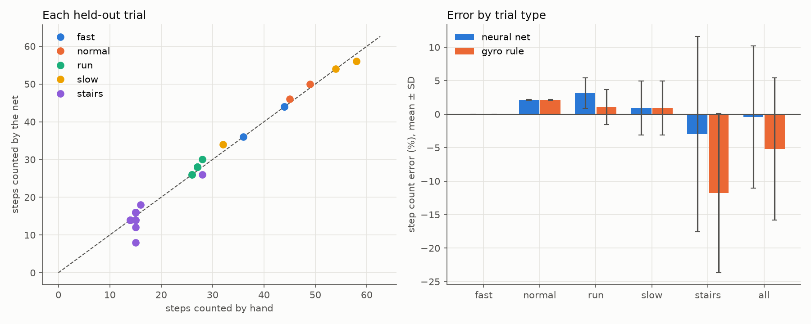

# StepCounter

The [GaitIdentifier](../GaitIdentifier/) wearable (Arduino UNO Q + MPU-6050 at the ankle), extended to **count steps with a neural net trained in PyTorch** and to **estimate how far you walked**. It still tells standing, walking, running and biking apart with the GaitIdentifier's decision trees.

- **Video of how it works:** [training/results/steps/how_it_works.mp4](training/results/steps/how_it_works.mp4), rendered from the real weights and training history by [make_animation.py](training/make_animation.py)
- **Phone page:** http://10.247.137.125:7000 (phone on Tufts Wi-Fi)
- **Demo video of the counter:** _TODO: link once filmed_

## Hardware

Same as the GaitIdentifier: everything is worn at the ankle in one 3D-printed housing, with the UNO Q, the battery and a GY-521 (MPU-6050) board mounted rigidly.

| GY-521 | UNO Q |
|---|---|
| VCC | 5V (power header) |
| GND | GND (digital header, below AREF) |
| SDA | SDA / D20 |
| SCL | SCL / D21 |

Axes as mounted: **X up the leg, Y forward, Z to the left**. The sensor runs at 100 Hz, ±16 g and ±2000 °/s.

**Sensors used.** The network gets every channel the wearable has: 3-axis acceleration, 3-axis rotation rate, and two derived channels (the total size of the acceleration and of the rotation). Streaming the phone's own motion sensors was considered and left out. iPhone Safari only allows motion sensors on HTTPS pages, and the board serves plain HTTP.

## How it works

```
 laptop (once)                                  ankle (live)
 ─────────────                                  ────────────
 data/*.csv ─► labels.py ─► train_steps.py      MPU-6050 ─► sketch.ino ─► Bridge ─► main.py
 (hand-counted   (gyro rule,   (PyTorch CNN,                                          │
  trials)         checked       cross-validated)                       stepnet.py (numpy forward pass)
                  against the        │                                     │
                  count)             └──► stepnet.json ─── copied ───►  strikes → steps, ZUPT → metres
                                                                           │
                                                                      phone page
```

1. **Network** ([train_steps.py](training/train_steps.py), class `StepCNN`). It's a 1D convolutional net: 4 layers of 16 filters, each filter 9 samples long, with dilation 1, 2, 4, 8, then a 1×1 output layer. That's 8,145 weights in total. Each output sample sees 1.21 s of input around it. It outputs a heel-strike probability for **every** sample.
2. **Targets.** At each labeled heel strike the target is a narrow Gaussian bump (σ = 30 ms), and 0 everywhere else. Standing and biking are all-zero examples.
3. **Training.** Binary cross-entropy (strike samples weighted ×10), Adam (learning rate 0.003, cosine decay), 40 epochs × 60 batches × 32 random 4 s clips. Random strap rotation (±20° about the leg), gain (±10%) and noise are added to every clip.
4. **On the board** ([stepnet.py](step-counter/python/stepnet.py)). The same convolutions run in numpy, matching PyTorch to within 2×10⁻⁵. Every 0.5 s the board runs the net on the last 4 s. It only uses outputs that have 0.6 s of data on both sides, so the count lags real time by about 1 s. A stretch above 0.5 is one strike. **Steps = 2 × strikes**, because the sensor sees one foot. The page shows them one at a time: the sensor foot's step when its strike is found, the other foot's half a stride later.
5. **Distance**, per stride (strike to strike of the sensor foot), two ways:
   - **Step-length model.** Stride = 2 × (a + b × cadence). People take longer steps when they go faster. A stride whose acceleration peaks above 9 g is **running** (running strides peak at 7.6–15 g, walking and stairs at 2–7 g) and gets its own a, because running steps are longer at the same cadence. Both are fitted to measured walks and runs.
   - **ZUPT (zero-velocity update).** The ankle is nearly still while the foot is planted. Between two foot plants, the gyro is integrated to track the sensor's orientation. The acceleration is rotated into the room's frame, gravity is removed, and the result is integrated twice. Whatever velocity is left at the second plant is drift, and is removed linearly. The horizontal distance is the stride length, times a correction factor fitted on measured walks. Running strides use the running step-length model instead (see limitations).

## Recording the test data

The numbers in the uncertainty analysis come from **counted trials**. Use the **Trial** tab on the phone:

1. Stand still. Pick the kind (slow / normal / fast / stairs / run) and press **Start**.
2. Walk while counting every step (both feet). Stop, stand still for about 1 s, then press **Stop**.
3. Type in your count and, if you walked a measured course, the distance. Press **Save**.

**Several people.** At the top of the Trial and Record tabs, tap who's wearing it, or add a new name. Every sample and trial is saved under that name, and the board remembers it across power cycles. Recordings from before names existed count as Anne's. With trials from two or more people, `train_steps.py` also runs a **leave-one-person-out** test: each person's trials are counted by a net trained without any of their data. That measures how well the counter works on someone new. Re-strap the sensor the same way on everyone (X up the leg, Y forward).

Suggested set (about 30 min): **5 each** of slow, normal and fast walking for 50–100 steps, at least 6 of them over a measured distance (e.g. a 30 m hallway, there and back). Add **3 stairs** and **3 runs**. Then copy the data off the board and retrain:

```
python3 -m venv .venv && .venv/bin/pip install torch numpy scipy matplotlib scikit-learn imageio-ffmpeg  # once
# copy ArduinoApps/step-counter/data/ (session_*.csv and trials.csv) into data/
.venv/bin/python training/train_steps.py      # cross-validated results + new stepnet.json
.venv/bin/python training/make_animation.py   # re-render the video from the new training run
python3 ~/AI_in_mobile_robotics/tools/deploy.py "$PWD/step-counter/app.yaml"   # put the new net on the board
```

## Results and uncertainty

### Data

**29 hand-counted trials, 771 steps**, all by one wearer (Anne): 3 slow, 2 normal and 3 fast walks, 7 runs, and 14 stair flights (up and down). 14 of them were over a measured distance (30 m, one of 20 m). Training also uses about 11 min of the GaitIdentifier's labeled recordings (walking, running, standing, biking).

On 22 trials, the gyro rule's strikes matched the hand count within 1, so they're used for training. The other 7 (5 stair flights, 1 slow walk, 1 earlier stair trial) are **only ever tested on**, never trained on.

### Step count (cross-validated)

Each trial is counted by a net trained **without** it (5-fold cross-validation by trial). The baseline is the gyro rule alone, its threshold tuned on the same training folds. Error is net count minus hand count; the 95% confidence interval on mean |error| is bootstrapped over trials. Full table: [trials_eval.csv](training/results/steps/trials_eval.csv).

| Trials | Neural net: mean error ± SD | Mean \|error\| (95% CI) | Gyro rule: mean \|error\| (95% CI) |
|---|---|---|---|
| Slow (3) | +0.0 ± 1.6 steps | 3.2% (0–6.2%) | 3.2% (0–6.2%) |
| Normal (2) | +1.0 ± 0.0 steps | 2.1% (2.0–2.2%) | 2.1% (2.0–2.2%) |
| Fast (3) | +0.0 ± 0.0 steps | 0.0% | 0.0% |
| Run (7) | +0.9 ± 0.6 steps | 3.1% (1.6–4.7%) | 2.1% (1.1–3.2%) |
| Stairs (14) | −0.5 ± 2.2 steps | 9.5% (4.8–16.1%) | 13.8% (9.0–18.7%) |
| **All (29)** | **+0.0 ± 1.8 steps** | **5.8% (3.2–9.5%)** | **7.7% (4.6–11.0%)** |



**What this says.** On level walking and running the net and the rule are equally good, within about 1 step of the hand count. That's the ±1 parity limit (below), so neither can do better there. The net's lead comes from **stairs**: it's within 2 steps on 12 of 14 flights, against 7 of 14 for the rule. Over all trials the net has no bias (+0.0 steps on average), and its error is ±1.8 steps (one standard deviation) per trial. The worst trial is a stair flight counted as 8 steps instead of 15.

**More data fixed descending stairs.** With the first 5 stair trials, the net counted two downstairs flights of 15 steps as **2 and 0 steps** (32% mean error on stairs). It had almost never seen walking down: its output only reached 0.6 at a downstairs strike, against 0.97–1.00 on level ground. After 9 more stair flights it counts those same two as 16 and 18, and stairs error fell to 9.5%. Running error fell from 9% to 3% the same way, from 2 to 7 run trials.

**Not stepping.** In the GaitIdentifier recordings, where the net was tested on the last 30% of each (against the rule's labels, not hand counts), biking gave **26 false steps from the rule and 2 from the net**. Standing gave 0 from both. The rule takes pedaling for strides; the net was trained on biking as "no steps".

### Known sources of error

- **±1 step parity.** The sensor sees one foot, so steps = 2 × strikes. Whether you started and stopped on the sensor foot is unknown, so any count can be off by one. On a 15-step stair flight, that alone is 7%.
- **Labels come from a rule.** Training labels are the gyro rule's strikes, kept only on trials where 2 × strikes matches the hand count within 1. The net learns the rule's timing, but also what is *not* a step.
- **Hand counts.** Miscounting by a step or two in 50 is 2–4%, about the size of the error being measured.
- **Small test set.** 2–3 trials per walking speed gives wide confidence intervals; the stair and overall numbers are the most solid.
- **One wearer.** Every trial is the same person. The page can record several people, and `train_steps.py` will then test each person on a net that never saw them, but that hasn't been done, so the accuracy on someone else is unknown.

## Distance: limitations and accuracy

Cross-validated the same way: each trial's distance comes from models fitted on the other folds' measured trials. Stair flights weren't measured.

| Trials | Step-length model: error ± SD (mean \|error\|) | ZUPT: error ± SD (mean \|error\|) |
|---|---|---|
| Slow (3) | −3.3 ± 6.6% (5.1%) | −2.1 ± 3.1% (2.8%) |
| Normal (2) | +0.2 ± 5.6% (5.6%) | +0.7 ± 1.1% (1.1%) |
| Fast (2) | −2.2 ± 3.6% (3.6%) | +1.0 ± 1.3% (1.3%) |
| Run (7) | +1.9 ± 5.7% (4.3%) | −0.2 ± 7.9% (6.7%) |
| **All (14)** | **−0.0 ± 6.1% (4.6%)** | **−0.3 ± 5.9% (4.3%)** |

So over 30 m, the estimate is typically within about **1.5 m**. On walks, **ZUPT is the more accurate** (1–3%), because it measures each stride rather than assuming a length. On runs, the step-length model is.

The fitted models (final, all trials): walking stride = 2 × (0.155 + 0.246 × cadence) m, running stride = 2 × (0.485 + 0.246 × cadence) m, with cadence in steps/s. At the same cadence a running step is 0.33 m longer. ZUPT's correction factor is 0.84.

**How running was fixed.** At first one step-length model and one ZUPT correction were fitted to every trial. The runs pulled both off: ZUPT was 33% wrong on runs and 17–20% wrong on walks, and the step-length model 8% overall. Two changes, both learned from the trials:

1. A stride whose acceleration peaks above 9 g counts as running (every running stride peaked at 7.6–15 g, every walking and stair stride at 2–7 g). Running strides get their own step-length intercept, fitted on the run trials.
2. ZUPT's correction factor is fitted on walking trials only, and running strides use the running step-length model instead of ZUPT.

ZUPT on walks went from 17–20% error to 1–3%, and the step-length model from 7.8% to 4.6% overall.

What limits it:

- **ZUPT doesn't work for running.** The foot is planted for only about 0.2 s, so the ankle is never still, which is what ZUPT relies on. And at 100 samples a second, the sensor catches only a few samples of each 10–15 g impact. (The accelerometer doesn't clip: the highest reading was 15.5 g of its 16 g range.) Running distance is the step-length model's, so it depends on your stride matching the trials'.
- **The ankle isn't the foot.** Even walking, a shank-mounted sensor rotates about the ankle during stance (about 50 °/s), so it isn't quite still at the foot plant. The linear drift correction and the fitted 0.84 factor absorb this, for this wearer.
- **Fitted to one person.** The step-length models and ZUPT factor come from Anne's walks. Someone with a different height or stride gets a biased step-length estimate. ZUPT should transfer better, since it measures each stride.
- **One running pace.** All 7 runs were 30 m at about the same pace, so the running model only has its own intercept; its slope is the walking one. A sprint or a jog well outside that pace is extrapolated.
- **First and last strides.** The first swing after standing counts as half a typical stride. The last stride before stopping uses the step-length model, because there's no next foot plant to integrate to.
- **Stairs.** Both methods report horizontal distance, which is short on stairs. That's correct, but it isn't "distance walked", and it wasn't measured.
- **Heading is not tracked.** Each stride's length is measured, but not its direction, so this is distance, not a map.

## How the neural net works (≤ 3 paragraphs)

_TODO: write in your own words. This is the part graded on understanding. The video and the "How it works" section above have everything it needs to cover: what goes in, what a convolution and ReLU do, why the layers are dilated, what comes out and how it becomes steps, what the loss measures, what backpropagation computes, and how Adam uses that to change the weights._

## Files

| | |
|---|---|
| [step-counter/](step-counter/) | App Lab app (deploy with `deploy.py <path>/step-counter/app.yaml`) |
| [step-counter/python/main.py](step-counter/python/main.py) | board: Bridge, live counting, trials, web APIs |
| [step-counter/python/stepnet.py](step-counter/python/stepnet.py) | numpy forward pass, strike tracker, ZUPT (shared with training) |
| [step-counter/python/stepnet.json](step-counter/python/stepnet.json) | trained weights + fitted distance models |
| [step-counter/assets/index.html](step-counter/assets/index.html) | phone page: Live, Trial, Record |
| [training/labels.py](training/labels.py) | loading data, gyro-rule heel strikes, matching a hand count |
| [training/train_steps.py](training/train_steps.py) | PyTorch training, cross-validation, uncertainty analysis, export |
| [training/make_animation.py](training/make_animation.py) | the explainer video |
| [training/plot_network.py](training/plot_network.py) | [the network as neurons and layers](training/results/steps/network_diagram.png) |
| [training/train_activity.py](training/train_activity.py) | the GaitIdentifier's activity trees (unchanged) |
